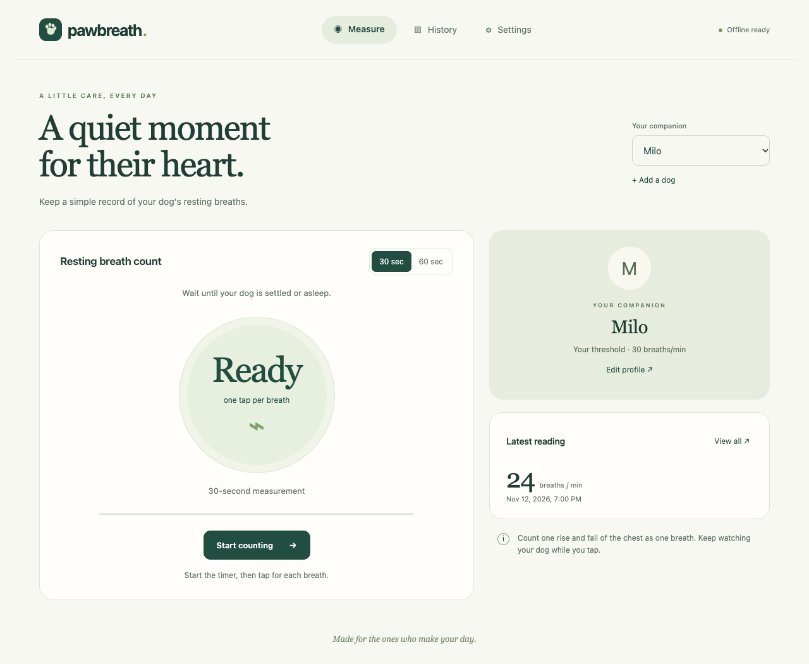

# Pawbreath

A mobile-first breathing journal for dogs: timed 30/60-second counts, multiple profiles and photos, manual entries, measurement context, notes, history charts and backups. Each browser keeps its own journal; there are no accounts or sync across devices.



Local preview with sample data. **Production: 1.2.0 build `49910c45716f`, verified 15 November 2026.** See the [changelog](CHANGELOG.md), [development plan](docs/dev_plans/20261112-feature-pawbreath.md), [focused counting checks](docs/dev_plans/20261114-feature-focused-counting.md) and [tap replay verification](docs/dev_plans/20261114-feature-breath-timing-replay.md). Physical Safari and installed-app checks on iPhone 12 and iPhone 17 Pro Max remain pending.

The new `/about` introduction (not yet deployed) explains counting, heart-failure monitoring, phone installation and local storage. Settings and the footer on every journal page link to it in a new tab. About shares the footer's tagline and styling, with a return link to the journal. Its History screenshot uses fictional Milo readings. The introduction needs a connection; the journal and its existing breathing guidance remain available offline after setup. The app stays at `/` with the same installed identity and journal storage. See the [introduction plan and checks](docs/dev_plans/20261115-feature-about-landing-page.md).

## Install and use

On iPhone, open the hosted HTTPS site in Safari and choose **Share → Add to Home Screen**. On Android, use **Install app** or **Add to Home screen**. Open online once and check for **Offline ready** before relying on offline loading.

Add a dog, wait until they are settled or asleep, and start a count. Start opens a dedicated counting view: tap anywhere in the large area once per breath while watching your dog. Undo and Cancel stay separate. When the timer ends, review the result, then save. Leaving the app cancels an active count; zero-breath counts cannot be saved. The result card ignores touches for about half a second after a count ends, so a late tap meant for the large area cannot press Save reading or Discard. Failed saves retain the result for retry. Manual entries record a rate and original local date/time without inventing a count or duration; future dates and years before 1970 are rejected.

Enable **Quiet tap sound** before starting for optional feedback. Ticking it checks whether this device can play audio: the status line says **Tap sound on** only when audio was running at that check, otherwise “Tap sound is not available on this device” and the box unticks. When you press Start the line reads “Tap sound is on for this count. Keep this screen open while counting.” This reflects the tick's availability check and your choice, not audio confirmed at Start; the first tap recovers it if audio was interrupted. It is off on page load and stays selected across counts until reload. If audio is interrupted mid-count (for example by a call), later taps try to restore it. Ending a count or unticking the box silences any tone still playing. Device volume or mute settings can still silence it; counting works without sound.

Readings can be labelled asleep, resting, restless or context not recorded, with an optional uncertainty flag. History applies date/context filters to both chart and list. Saving an entry clears conflicting filters so it stays visible. Profiles are editable; reading deletion asks for confirmation.

For new timed readings, tap a chart point or **Replay taps** to replay that reading. **Replay newest first** plays visible readings one at a time, newest to oldest. The selected point pulses at the recorded tap times, silently at original speed, including gaps at the start and end of each 30/60-second count. A static timeline shows the taps; reduced motion keeps the point still. Stop, filter or dog changes, History data changes (a save, restore or update from another tab), navigation, opening a form or a confirmation dialog (such as deleting a reading), starting a measurement and leaving the app stop playback. Old and manual readings show “Tap timing unavailable” and are skipped by **Replay newest first**.

The cached breathing guidance explains measurement context and when to seek veterinary advice. Thresholds start blank: enter the value your vet recommends. The general 30 breaths/min reference never sets that value automatically. The app compares readings against the entered threshold without diagnosing a condition. External source links require connectivity.

## Storage and backups

Data stays in IndexedDB on this device/browser and hostname. The last-chosen dog is remembered per browser; readings stay in IndexedDB only. Clearing browser data or losing the device can lose the journal. Download JSON backups from Settings regularly. Export CSV sits beside them in Settings; CSV exports include all dogs and readings with UTC timestamps, regardless of History filters.

Restore validates the complete backup and adds missing records in one transaction, preserving existing records with matching IDs. A previous backup can recover deleted readings. Export and restore share validation rules and have no fixed aggregate size/count limit; browser resources still limit capacity.

New backups use format 2 until a reading has tap timing, so older apps (1.1.0) can still restore them; a backup containing timing uses format 3. Restore accepts versions 1, 2 and 3. New timed readings retain accepted tap offsets in milliseconds, including Undo corrections; old and manual readings have no invented timing. JSON preserves timing; CSV stays a summary. Older apps reject format 3 backups, and exporting through an old app can strip timing. Do not roll back after recording with 1.2.0. Manual records retain their source, context and uncertainty; CSV leaves their count/duration fields blank. Version 1.0 cannot export backups containing 1.1.0 manual records, so before rolling back export a backup from 1.1.0, and do not roll back while manual entries are present.

## App updates

Settings shows running/published versions, the last successful check and **Check for updates**. Checks also run on launch, reconnection and resumption. **Offline ready** means the app is cached, not necessarily current.

When **Update ready** appears (a notice that arrives during a count stays behind the counting view and is announced to screen readers once the count ends), save your work, fully close the installed app and all Pawbreath browser tabs, then reopen. Downloaded updates can activate offline and retain the journal. They never force a reload during a count or form edit. Unsaved work does not survive intentionally closing the app. Older releases gain the version panel only after completing this upgrade cycle.

## Develop and verify

The tracked `dist/` directory is the app source; no runtime build or package installation is needed for a basic preview:

```sh
python3 -m http.server 8766 --bind 127.0.0.1 --directory dist
```

Open <http://127.0.0.1:8766>. Use localhost HTTP or hosted HTTPS for service workers. Python exposes the introduction at `/about.html`; use `just dev` to check Cloudflare's `/about` URL and redirects.

With Node.js 22.12+ and [just](https://github.com/casey/just):

```sh
just install        # Install locked development dependencies
just dev            # Workers preview on port 8766; accepts another port
npm test            # Node tests, release metadata and syntax checks
node tests/browser-check.mjs
just deploy-check   # Tests and Wrangler dry run; does not deploy
```

Open the browser harness's printed file to run its checks. It uses an isolated database and simulated worker registration. Actual worker upgrades require a served test; iPhone installation and lifecycle checks require the device.

`package.json` owns the release version. To change it, use `npm version 1.2.1 --no-git-tag-version` with the intended version. Run `npm run release` after final app edits, then commit the changed source, package/lockfile and generated `dist/version.mjs`, `dist/release.json` and `dist/sw.js`. Tests reject stale metadata. App, backup and database versions are independent.

## Deploy to Cloudflare

[Workers Static Assets](https://developers.cloudflare.com/workers/static-assets/) serves `dist/` at `pawbreath.com`, with no server-side journal or runtime secrets. The site is public; visitors see only their own browser's data.

```sh
just cf-whoami      # Check authentication
just deploy        # Tests, authentication, then production deployment
```

Keep credentials outside the repo. These commands load `~/.secrets/cf.env` when no `CLOUDFLARE_API_TOKEN` is exported. Use shell assignments for that token and `CLOUDFLARE_ACCOUNT_ID`. An explicit `CLOUDFLARE_ENV_FILE=/absolute/path/to/file.env` overrides exported credentials; otherwise Wrangler can use its existing login. Preview and dry runs do not load this file.

Deployment requires a clean tracked `dist/`, including no ignored/untracked files: everything there can become public. Wrangler manages the apex custom domain; Cloudflare's dashboard separately manages HTTP/`www` redirects to HTTPS apex, preserving paths/queries. Keep the `www` placeholder A record (`192.0.2.0`) proxied and the redirect enabled. `dist/_headers` sets the security policy and cache controls. The host must serve shell files byte-for-byte (no HTML rewriting, minification or injection); the service worker verifies each file's SHA-256 at install, so any change makes installation fail and offline mode will not activate. After deployment, verify HTTPS, redirects, offline reopening and the installed app.
