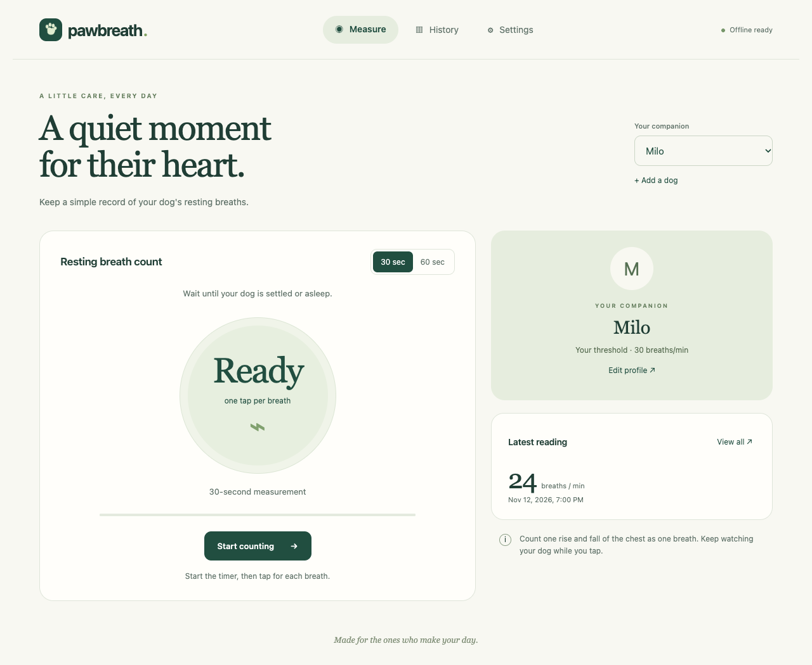

# Pawbreath

A mobile-first breathing journal for dogs. The app supports timed 30/60-second tap counting, multiple dog profiles and photos, measurement context, manual entries, notes, date-filtered charts, owner-entered thresholds, CSV export, and versioned JSON backups.



Local browser preview with sample data.

## Run locally

From this directory, start a static server.

```sh
python3 -m http.server 8766 --bind 127.0.0.1 --directory dist
```

Open <http://127.0.0.1:8766>. Running the app this way needs no package installation or build step; the Cloudflare tools below are only for deployment and the Workers preview. Use HTTP on localhost or HTTPS when hosted, because browser modules, service workers, and home-screen installation need the appropriate origin.

To install on an iPhone, open the hosted HTTPS URL in Safari, choose Share, then Add to Home Screen. On Android, use the browser's Install app or Add to Home screen action. Open the app online once and check that it reports “Offline ready” before relying on offline loading.

## Storage and measurement behavior

- Each device/browser keeps its own IndexedDB journal. Data does not synchronize across people or devices.
- Download JSON backups from Settings to protect readings against device loss or clearing browser data. CSV exports include all dogs and use UTC timestamps.
- Restore validates the complete backup before beginning one transaction. It adds missing IDs and keeps existing records on conflicts. A previous backup can restore a reading deleted since that backup.
- Backups have no fixed record-count or file-size limit. Export and restore validate the same format and record rules; available browser memory and device storage limit how large a journal can be processed.
- Timed readings can record asleep/resting/restless context and an uncertainty flag at save time. Existing readings show context as not recorded; no state is inferred from old notes.
- Measure includes expandable, sourced breathing guidance that is available offline. It distinguishes settled sleep from calm-awake rest and explains when to seek veterinary advice. The general 30 breaths/min reference never fills the optional vet threshold or produces an automatic normal/abnormal classification. No threshold adjustment is made for breed, weight, sex or neuter status.
- History can filter by context as well as date. The chart and list use the same filters; uncertain readings remain visible and labelled, and older records with no context can be selected separately. CSV and JSON continue to include all dogs and readings. Saving a timed or manual entry widens an incompatible filter so the new reading stays visible.
- Use “Enter a previous reading” on Measure or “Enter a reading” on History to enter a rate and its original date/time in the device’s current time zone. Manual entries are labelled and retain no invented raw count or duration. Future dates and years before 1970 (such as a two-digit year typed by mistake) are rejected.
- New JSON backups use format version 2 and retain source, context and uncertainty; version 1 backups remain importable. Older app versions cannot import version 2 backups. CSV includes the new fields and leaves count/duration blank for manual entries. IndexedDB stays at schema version 1 because the existing stores need no structural migration.
- Each measurement starts with an explicit Start action. Taps at or after the deadline do not count. Zero-breath sessions cannot be saved. Leaving the app during a count cancels that measurement.
- Save confirms only after the database transaction commits. A failed save retains the completed reading for retry.
- Thresholds start empty. Enter the value your vet recommends. The app displays a comparison at or above that value.
- Profiles can be edited. Individual readings can be deleted after confirmation. Dog deletion and cloud accounts are outside this version's scope.
- Service-worker updates wait until all existing app windows close. They never force a reload or interrupt a measurement or unsaved form.

## App version and home-screen updates

Settings → **App version and updates** shows the running release and build ID. **Check for updates** checks the published release over the network, with a last-successful-check timestamp. Checks also run on launch, reconnection and when resuming the app (at most once per minute for resume events). “Offline ready” means the shell is installed; it does not mean the release is current.

When **Update ready** appears, finish and save your reading, fully close the home-screen app and any Pawbreath browser tabs, then reopen. The waiting update can activate without a connection once downloaded. Check again online to confirm that the running release/build matches the published one. While offline, the app shows its running version and previous check time, without claiming to know the latest published version. Updates retain the journal in IndexedDB.

For releases, `package.json` owns the version. Use `npm version 1.1.1 --no-git-tag-version` (substitute the intended version), then `npm run release` after the final app edits. Commit the package/lockfile and generated `dist/version.mjs`, `dist/release.json`, and `dist/sw.js` along with the changed app files. The build ID hashes deployed source, including the worker and response headers. `npm test` and `just deploy` reject stale generated metadata. The running app, published release and offline cache use the same identity; backup format and database schema versions remain independent.

The version/status UI first appears after upgrading from older releases. Until then, open the old app online, allow its update to download, fully close its windows and reopen. The new UI cannot be displayed by an older cached app before that upgrade.

## Verify

```sh
node scripts/release.mjs --check
node --test tests/*.test.mjs
node --check dist/app.js
node --check dist/data.mjs
node --check dist/updates.mjs
node --check dist/sw.js
```

An optional browser harness combines the current source into a temporary HTML file and uses a fresh test database on every load. It exercises real IndexedDB writes, aborted commits, import rollback, concurrent connections, duplicate restores, hostile text, timer boundaries, interrupted sessions, manual entries and context. A simulated worker registration verifies that update notices and checks preserve active counts, pending results and manual drafts.

```sh
node tests/browser-check.mjs
```

Open the printed temporary file in a browser to run it. The title and an on-page report show its results. Test databases use `pawbreath-verification-*` names. The harness does not test service workers. For a served browser check, also verify the 375px mobile layout, offline reload, install-to-home-screen flow, and a worker update while a count is running.

## Cloudflare Workers

Deploy the static app to `pawbreath.com` using [Workers Static Assets](https://developers.cloudflare.com/workers/static-assets/). The Wrangler configuration uploads only `dist/` and attaches the apex domain. There is no app build step or server-side database. Journal data stays in the browser, and each hostname has its own journal storage. The deployed site is publicly reachable with no access control, so anyone with the URL can load the app, but they can only see journal data stored in their own browser.

Install Node.js 22.12+ and [just](https://github.com/casey/just), then run:

```sh
just install        # Install the locked Wrangler development dependency
just dev            # Local Workers preview at http://127.0.0.1:8766
just test           # Full Node suite and syntax checks
just cf-whoami      # Read-only account/authentication check (JSON)
just deploy-check   # Tests and a local deployment dry run
just deploy         # Tests, authentication check, then production deployment
```

Use `just dev 8767` if the default port is already occupied.

`just deploy` refuses to run unless `dist/` matches git exactly (no untracked, modified or ignored files such as backups or `.DS_Store`), because Wrangler uploads every file present in `dist/` to the public site.

`just cf-whoami` and `just deploy` load `~/.secrets/cf.env` if `CLOUDFLARE_API_TOKEN` is not already exported. The file should contain shell-compatible assignments for `CLOUDFLARE_API_TOKEN` and `CLOUDFLARE_ACCOUNT_ID`. To use another file, set `CLOUDFLARE_ENV_FILE=/absolute/path/to/file.env`; relative paths (including bare names and `~` left unexpanded) are rejected. An explicit file override takes precedence over exported credentials; an unreadable override fails immediately. Without a file or exported token, Wrangler uses its existing login (`./node_modules/.bin/wrangler login`). Local preview and dry runs do not load the external credential file.

Deployment is expected to need a token scoped to the target account with Workers Scripts edit access, plus Zone read and Workers Routes write access for `pawbreath.com` ([Workers permissions](https://developers.cloudflare.com/workers/authorization/workers/)). These scopes are unverified: creating the custom domain may also need DNS edit, so adjust the token if the first `just deploy` is rejected. The domain must be an active Cloudflare zone in that account, and the apex must have no existing A, AAAA or CNAME record, or custom-domain creation will fail. The deployment config creates the custom-domain association and disables `workers.dev` and preview URLs. It does not configure `www.pawbreath.com`. After deployment, verify HTTPS, offline reload and home-screen installation at the final hostname.

Keep credential files outside the repository. `.env*`, `.dev.vars*`, `.openai/`, `node_modules/` and `.wrangler/` are ignored. The runtime site does not need any Cloudflare credentials.

Cloudflare's dashboard separately manages the `Canonical HTTPS and apex` redirect rule and a proxied `www` A record pointing to the reserved placeholder `192.0.2.0`. The rule sends HTTP apex requests and all `www` requests to `https://pawbreath.com` with status 301, preserving paths and query strings. Keep that DNS record proxied and the redirect enabled; Wrangler does not manage these zone settings.

`dist/_headers` applies a same-origin Content Security Policy, blocks framing and MIME sniffing, and keeps the service-worker script revalidated. Profile photos may use data and blob URLs. The shell cache is versioned whenever the cached assets or their security policy changes.

## Current delivery state

The 1.1.0 feature branch includes measurement context, manual entries, the release/update UI, sourced breathing guidance and a History context filter. All 38 Node tests, syntax checks and the expanded 16-check Chromium browser harness pass. The new guidance and History filter fit at 375px without horizontal overflow. A separate served test with the actual service worker confirms the guidance loads after an offline reload. The earlier manual-form and version-panel visual checks also passed.

Follow-up verification on 13 November 2026 passed `npm test` and `just deploy-check`, including the Wrangler dry run. A separate localhost Chromium test upgraded the actual service worker from build `b54a8e48353a` to `a3f2bc133df7`. The update waited while a real count completed and while result notes, a manual entry and a profile edit were unsaved. Closing one of two app tabs left the update waiting and the other tab's draft intact. After saving and closing every app tab, the new build opened offline with identical journal data and readable guidance. Offline checks also verified chart/list filtering, complete CSV/JSON exports and visibility after timed and manual saves. The file-based harness continues to simulate worker registration; these upgrade results come from the separate served test.

Release 1.1.0 has not been deployed. Physical iPhone checks remain: Safari home-screen installation, offline reopening after fully quitting, update activation with both Safari and the installed app open, and lock-screen/app-switch interruptions cancelling active counts. Save forms and completed readings before closing; unsaved work is retained during update checks and downloads, not across an intentional app shutdown.

For the previously deployed baseline, production HTTPS and the HTTP/`www` redirects have been verified. The user reports completing phone installation, offline reopening, persistence, backup/restore and worker-update checks. A first resting-dog measurement remains pending.

A private Site was originally registered, with its identity saved locally in the ignored `.openai/hosting.json` file. Cloudflare Workers is now the production host; the Sites identity is retained locally but is not used by the recipes above.

The app now lives in the standalone [Pawbreath repository](https://github.com/vr000m/pawbreath), moved from `tinkerbox/www/pawbreath`. Run the commands above from this repository's root. Git tracks `dist/` as app source; local hosting configuration in `.openai/`, credentials, editor state and verification output are ignored.
