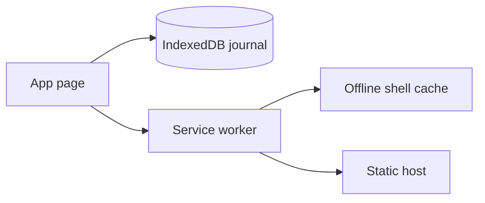

# Pawbreath home-screen app

**Status:** In review — 1.1.0 implemented; phone-first layout pass (PR #4) desktop- and emulator-verified; physical-device acceptance pending
**Component:** Pawbreath
**Branch:** feature/mobile-layout-pass
**Date:** 2026-11-12
**Updated:** 2026-11-13
**Objective:** Provide an offline dog breathing journal on a phone.

## Scope and architecture

A static HTML/CSS/JavaScript app with device-local IndexedDB storage. No third-party runtime dependencies, accounts or cloud journal storage. Cloudflare Workers serves the app publicly; each browser/hostname has a separate journal. Operational commands are in the [README](../../README.md); user-visible changes are in the [changelog](../../CHANGELOG.md).

| Files | Responsibility |
| --- | --- |
| `dist/index.html`, `app.css`, `app.js` | Profiles/photos, counter, manual-entry forms, guidance, History and Settings |
| `dist/data.mjs` | Validation, transactional storage, CSV and JSON backup/restore, `CONTEXT_LABELS`, `withReadingDefaults`, `defaultDogId` and `manualDialogAction` |
| `dist/updates.mjs`, `sw.js` | Update status and scoped offline shell; no journal writes |
| `scripts/release.mjs`, `scripts/lib/precache-assets.mjs`, `dist/version.mjs`, `dist/release.json` | Deterministic app release/build identity; published metadata is network-only |
| `dist/manifest.webmanifest`, icons | Home-screen installation |
| `wrangler.jsonc`, `dist/_headers`, `scripts/cloudflare.sh`, `justfile` | Hosting, security headers, external credentials and deployment checks |
| `tests/` | Data/worker/update/deployment tests, `manual-dialog.test.mjs`, `structure.test.mjs` (including the phone-layout and 16px-control checks) and browser harness |

## Decisions and invariants

- **Measurement:** explicit Start, 30/60-second timer, one tap per breath and undo. Deadline taps do not count; zero-breath and interrupted/backgrounded counts cannot be saved. Timed records retain date, count, duration and derived rate. Manual records retain the original local date/time and a positive rate up to 300 with one decimal place, with null count/duration. Reject future/nonexistent local times and years before 1970.
- **Context and guidance:** record asleep/resting/restless/not-recorded and optional uncertainty. Never infer legacy context from notes. General guidance never fills the optional vet threshold or labels a result safe/normal. No breed, weight, sex or neuter adjustment is applied. Guidance is cached; linked sources require internet access.
- **History:** chart and list share date/context filters; uncertain readings stay labelled. Timed/manual saves clear incompatible filters. History has no export control: CSV and JSON (backup) export are in Settings and retain all dogs/readings.
- **Persistence:** IndexedDB `pawbreath`, schema 1, with `dogs` and `readings` stores keyed by ID. Confirm saves only after transaction commit; retain failed results/drafts and stable IDs for retry. Concurrent tabs must preserve distinct writes. Dirty manual dialogs require Save/Discard and retain drafts after repeated Escape. Profile photos are resized; user text renders literally. Reading deletion requires confirmation. The last-chosen dog ID is remembered in `localStorage` (key `pawbreath.dog`) as a per-browser convenience only: reads and writes are wrapped in try/catch, a missing or stale ID falls back to the dog with the most recent reading, else the first dog, and no reading data is ever stored there.
- **Recovery:** backup format 2 accepts format 1 imports, normalizing old records without guessing context. Old apps reject format 2. Validate a complete backup before one atomic, additive restore; existing IDs win. Export and import accept the same valid snapshot domain without aggregate count/byte caps, subject to browser resources. CSV neutralizes formula prefixes and offers best-effort rows for invalid stored records.
- **Updates:** package version plus generated build hash identifies the running app, published metadata and shell cache. Hash deployed source recursively, excluding dotfiles/generated identity. Check metadata in tests; at install the worker rejects a `version.mjs` carrying a different build and verifies every precached shell file's SHA-256 against the generated `DIGESTS` manifest in `sw.js`; any mismatch aborts installation and caches nothing, so the host must serve shell files byte-for-byte. Cache the scope root, not redirected `index.html`. No `skipWaiting` or forced reload: activate after all clients close, remove only obsolete Pawbreath caches, never touch journal storage. Save before intentionally closing; drafts are not durable across shutdown.
- **Update status:** check on launch, reconnect and resume (resume throttled to one minute), using uncached published metadata and `updateViaCache: none`. Offline/failed checks never claim freshness; optional last-check storage failures cannot block the app.
- **Deployment:** require clean tracked `dist/` and successful JSON authentication before publishing. Credentials remain external; the app needs none. Same-origin CSP allows data/blob profile images, blocks framing and MIME sniffing. Wrangler owns the apex association; dashboard-managed HTTP/`www` redirects remain separate.

## Decision history

- **2026-11-12:** Moved from `tinkerbox/www/pawbreath` into a standalone repository. Cloudflare Workers replaced the proposed owner-private Sites host; the unused Sites identity stays ignored locally. The public static host adds no shared data access.
- **2026-11-12:** Removed backup aggregate limits after additive restores produced valid journals that could not round-trip. Workers' `index.html` redirect required caching only the scope root. The earlier three-round gauntlet remained non-converged; subsequent manual code/security/docs checks closed its remaining security-header finding before the baseline merge/deploy. Do not relabel that historical gauntlet as converged.
- **2026-11-13:** Added manual/context records and backup format 2 without changing IndexedDB schema. Replaced fixed cache versions with generated release/build identity. Review fixes cover dirty-dialog retention, date/rate bounds, CSV recovery and worker build matching. Added informational guidance and comparable History without automatic clinical thresholds.
- **2026-11-13:** Phone-first layout pass. Measure fits one screen with Start pinned above the tab bar; History gets its own dog picker; the app opens on the last-chosen dog, else the dog with the newest reading (`defaultDogId`), because the first-alphabetical default hid a real reading; CSV export moved to Settings because it covers every dog; Save/Cancel stay visible in the manual dialog; install help hides once installed; "Enter a reading" moved beside the Recorded moments list; form controls are at least 16px so iPhone does not zoom; on phones an update notice that arrives mid-count is visually hidden (still announced) until the count ends, so the circle clears the pinned controls; on phones 640px tall or less the duration picker and instruction also hide mid-count, and below 560px the (disabled) dog picker too, so the circle clears the bar down to about 460px tall. Wide screens keep the same picker position on Measure and History.
- **2026-11-13:** Consolidated this plan to retain decisions and final evidence. Superseded permission failures, interim test counts and handoff logs remain in Git history: `git show c28de322c645577736b5c040b1c950d0ff8a3838:docs/dev_plans/20261112-feature-pawbreath.md`.

## Verification and acceptance

Verified 13 November 2026 for release 1.1.0, build `189e7d3f95ee`:

- [x] `npm test`: 67 Node tests, release metadata and syntax checks pass; `just deploy-check` completes the Wrangler dry run.
- [x] Browser harness: 20 checks (all pass in headless Chromium) cover real IndexedDB writes, failures/rollback, concurrent connections, repeated restore, hostile text, timer boundaries, manual entry, threshold independence, context filters, save visibility and the count circle clearing the pinned Undo/Cancel bar mid-count in a 320x480 frame. A long dog name in both pickers at 320px is a smoke check only (Chromium shrinks the select even without the fix); the structure test on the picker rules is its regression guard. Its worker registration is simulated.
- [x] Recorded 375px layout checks show no horizontal overflow; manual Save/Cancel controls remain reachable.
- [x] Phone layout pass checked in Chromium DevTools emulation at 390x844, 375x667, a 568px-tall phone and 320x480, plus 1280x800: Start reachable on Measure, the count circle clears the Undo/Cancel bar mid-count, both dog pickers start at the same position, no horizontal overflow. A Lighthouse mobile audit was run; the one open finding is the breath button's accessible name ("Count one breath") not matching its visible text.
- [x] Separate real localhost Chromium upgrade from `b54a8e48353a` to `a3f2bc133df7`: the worker waited through an active count, pending result notes, dirty manual form and profile edits. Closing one of two clients retained the remaining draft and kept the update waiting. After saving and closing all clients naturally, the new build reopened offline with identical journal data.
- [x] After that upgrade, offline guidance, actual chart/list filtering, complete CSV/JSON downloads and timed/manual save visibility passed. Tested assets matched `dist/` byte for byte; no forced activation was used.
- [ ] Physical phone: `position: sticky` Start/Undo/Cancel bar over the tab bar, the `:has()` mid-count title rule, and the install card hiding in `display-mode: standalone`.
- [ ] Physical iPhone: Safari home-screen installation and offline reopening after fully quitting.
- [ ] Physical iPhone: a long dog name truncates inside both pickers (Chromium and Firefox already shrink the select; Safari is unchecked).
- [ ] Physical iPhone: update activation with Safari and the installed app both open; lock-screen/app-switch cancellation of active counts.
- [ ] First measurement with a settled/asleep dog. User-reported checks of the deployed baseline do not verify this new release.
- [ ] Merge and deploy 1.1.0; verify the deployed identity, HTTPS/redirects and installed app.

No deployment was performed during this feature's verification. The earlier blocked dry-run/desktop-upgrade claims are superseded by these results. [PR #2](https://github.com/vr000m/pawbreath/pull/2) contains the feature review.

## Deferred work

Shared household access and automatic recovery need a separate design. The direction is local IndexedDB plus a durable upload queue, authenticated Worker API, D1 shared records and private R2 photos/backups. Preserve stable client IDs and server-verified authorship; use revisions, deletion markers and a server-ordered change cursor rather than device clocks alone. Migration requires explicit household mapping; retain local-only use and distinguish local saves from server acknowledgement. Independent retained backups and tested restore are required alongside sync. Authentication, retention and permissions remain undecided; no such resources are created here.

Vet reports, reading corrections/profile archiving, household reminders and external historical imports remain outside this release. Camera detection and medication scheduling are deferred.
