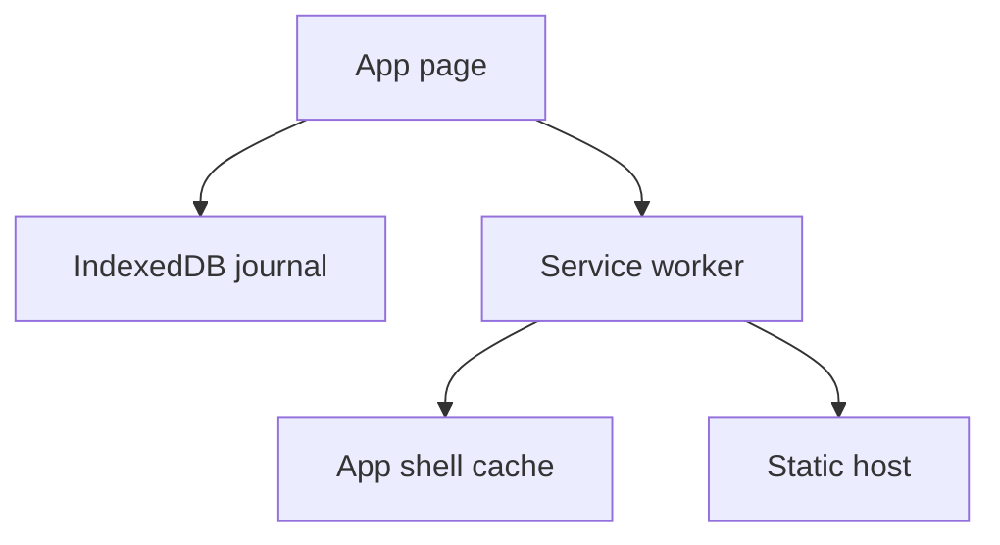
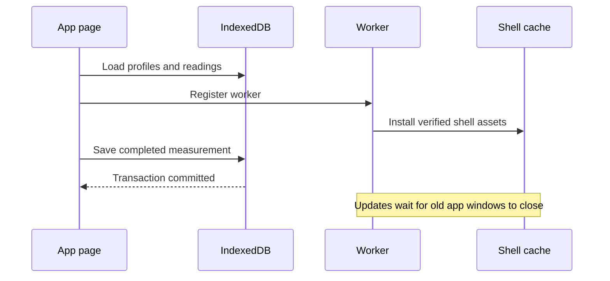

# Pawbreath home-screen app

**Status:** In review — 1.1.0 implementation and desktop verification complete; iPhone acceptance and publication pending
**Component:** Pawbreath
**Assignee** Codex
**Priority** Normal
**Branch:** feature/manual-readings-pwa-updates
**Date** 2026-11-12
**Objective** Provide a usable offline dog breathing journal on a phone.

## Context
The user chose a home-screen web app after discussing replacing Cardalis. Tinkerbox stores standalone web utilities under www. README.md describes this layout. www/queuing_system uses plain HTML/JS/CSS and dependency-free Node assertions. There is no shared frontend framework or root package manifest.

## Requirements
- Original responsive interface, working name Pawbreath.
- Dog profiles with optional photo and owner-entered threshold, initially blank.
- Explicit Start button for 30/60-second measurement, one tap per breath, undo, cancel, completion review, notes, and explicit Save. Zero breaths cannot be saved. Interrupted or backgrounded sessions are cancelled to avoid incomplete counts.
- Timestamp, raw count, elapsed seconds, derived rate and dog ID retained for each reading.
- IndexedDB transactional storage. Report save failures without clearing the result. Multiple tabs must not overwrite a whole stale snapshot.
- History, week/month/all filters, readable chart and exact readings. Confirm deletion.
- Versioned JSON backup and additive transactional restore with validation and idempotent IDs. Existing records win on duplicate IDs. CSV export with formula-safe user text.
- Offline app shell after initial online load, manifest and PNG icons. Changes activate only on a later launch, avoiding reload during measurement.
- Data is device/browser local, with clear backup guidance. Export/import supports moving devices. No cloud sync in this version.

## Implementation Checklist
### Phase 1 — Core experience
- Build static HTML, CSS, app controller and small data module.
- Implement counter, dog editing, history, notes, threshold and exports.
### Phase 2 — Home-screen support
- Add scoped service worker, manifest, PNG icons and installation instructions.
### Phase 3 — Verification
- Exercise counts, interrupted timers, persistence, import validation/deduplication, export, responsiveness and offline reload.
- Update usage README and record observed verification limits.
- After verification, deploy to the newly created owner-private Site using an isolated publishing copy of this source. Verify installation on a phone separately. (Superseded by "2026-11-12 Cloudflare deployment tooling" below: hosting moved to Cloudflare Workers Static Assets.)

## Technical Specifications
All new files live under www/pawbreath. dist/index.html is the entry, dist/app.css and dist/app.js own the interface. dist/data.mjs owns validation, CSV serialization and IndexedDB transactions. dist/sw.js caches only the enumerated local app shell, dist/manifest.webmanifest and icons enable installation. tests/data.test.mjs checks validation and serialization using node:test. README.md documents operation and storage. The ignored local .openai/hosting.json holds the registered Site identity and static directory dist. (Superseded: see "2026-11-12 Cloudflare deployment tooling"; the Site identity is retained but unused.) No build or third-party runtime dependencies.

IndexedDB database pawbreath, version 1, has dogs and readings stores keyed by ID. Each write uses a narrow transaction. Backups contain format pawbreath, version 1, dogs and readings. Validate length limits, finite positive numeric fields, dates, ID uniqueness, references and photo format before any write. Import is atomic and additive. Photo uploads are resized before storage. All user strings render through textContent or escaped markup.

### Integration Seams
App calls the data module for reads/writes and registers the service worker on the same origin. Service worker performs no data writes. Sites hosts static files and supplies owner-only access. (Superseded: Cloudflare Workers Static Assets now hosts the files; see "2026-11-12 Cloudflare deployment tooling". No owner-only access control is configured in this repository.) Deployment success proves hosting, while iPhone installation and private-gateway offline behavior require real-device verification.

## Testing Notes
Use node --test tests/data.test.mjs and browser tools against local HTTP. Verify both empty and populated states at mobile and desktop widths. Use a controlled clock for timers where supported. Inspect successful service worker install and offline reload. Keep test records confined to local preview.

The browser harness tests failed commits, mid-import rollback, concurrent database connections, hostile markup as text, and deadline taps. Node tests cover malicious CSV values, malformed backups and worker fetch/cache behavior. A live served browser still needs a two-version worker update during a measurement and an offline reload.

## Architecture & Call Flow
The page reads and writes IndexedDB. A separate service worker caches the app shell after initial network access. It never writes journal records. Newly installed workers wait for all existing windows to close before activating, and activation cleans only obsolete Pawbreath shell caches.

| Step | Trigger | Enters context | Cleared/persisted | Turn boundary |
| --- | --- | --- | --- | --- |
| Startup | Open app | Profiles and readings | Database retained | Page lifecycle |
| Measurement | Start and tap | Count and deadline | Unsaved result in memory | Timer callbacks |
| Save | Save reading | Validated record | Transaction commit | Database callback |
| Shell install | Register worker | Enumerated asset responses | Cache retained | Worker lifecycle |
| Update | All old clients close | New shell version | Old app caches removed | Worker activation |

## Review Focus
Timer boundaries, interrupted counting, truthful persistence feedback, atomic restore, duplicate imports, offline shell updates, output escaping and data portability.

## Acceptance Criteria
- A user can add a dog, record a timed reading, save it and recover it after reload.
- History renders actual records with date filtering and notes.
- Backup restores to an empty store and repeated imports create no duplicates.
- Invalid backups leave existing data untouched.
- Shell loads offline after caching, with no externally hosted runtime assets.
- Phone layout fits 375px width with accessible controls.
- Private hosted URL is returned if publication succeeds, and remaining device verification is disclosed.

<!-- review pending -->

## Progress
- Site registered and manifest persisted.
- Implemented app UI, dog profiles and photos, counter, history chart, threshold, notes, JSON restore and CSV export.
- Added scoped offline worker, home-screen manifest and raster icons.
- All 11 Node tests pass. App, data module, worker, and generated browser harness pass syntax checks.
- Created a reproducible browser harness with isolated test databases. Browser execution remains blocked.

## Findings
Five review findings recorded. Added lifecycle diagrams and moved publication after verification. Added failure-injection, concurrent-write, hostile-text, and timer checks to the browser harness. Added CSV injection tests. Real worker-update testing remains pending because browser/server access is blocked.

## Issues & Solutions
- Local HTTP listener was denied with EPERM by the execution sandbox.
- Hosting source Git endpoint could not resolve. Site creation succeeded but no source version was published.
- Browser tool stalled and was later removed. Computer-use browser rejected file navigation under its URL policy. No browser verification result is claimed.
- Review metadata was moved to scratch after integrating findings to keep the repository change focused on the app.

## Final Results
Working source is in www/pawbreath/dist with no runtime dependencies. Default name is Pawbreath. Storage is device-local. Remaining acceptance checks are real browser interaction, mobile layout, offline updates, phone installation, and deployment once network access is available.

## 2026-11-12 repository move
The app moved from `tinkerbox/www/pawbreath` into the standalone repository <https://github.com/vr000m/pawbreath>. Paths above describe the original implementation location; current paths are relative to this repository root, with the app in `dist/`. Initial import uses `feature/initial-import`. The root `.gitignore` excludes local hosting configuration, credentials, editor state and verification output while retaining app source. Hosting identity is preserved locally in the ignored `.openai/hosting.json` file. Browser, device and deployment verification remain pending.

## 2026-11-12 backup round-trip correction
Review found that additive restores can exceed the backup validator's aggregate record limits, and exports can exceed the file reader's 20 MB limit. These limits invalidate the data-portability requirement above: every valid stored journal must remain exportable and readable by restore, within browser memory and storage capacity.

Remove aggregate count and file-size limits while retaining format, per-record, uniqueness and reference validation. Route file parsing through a shared validated reader in `dist/data.mjs`, used by the restore handler in `dist/app.js`. Cover journals above 100 dogs and 50,000 readings, additive backup combinations, files above 20 MB and invalid file contents in Node regressions. Increment the service-worker cache version for changed shell assets and document the browser resource boundary in README.md. This corrects backup handling only; the outstanding browser/device/deployment checks remain pending.

Implemented and verified: all 14 Node tests pass, including the new aggregate and file-size regressions; the 11-check browser harness also passes in Chromium. Export, file reading and transactional restore all use `validateBackup`. The service-worker shell cache is now v2. Real-device installation and a two-version worker update remain unverified.

## 2026-11-12 Cloudflare deployment tooling
Cloudflare Workers Static Assets at `pawbreath.com` supersedes the original Sites publication target. Use an assets-only Worker with `dist/` as the complete public directory and the apex as its custom domain. No server-side journal, database binding or runtime secret is needed. The existing local Sites identity is retained but is not used by this workflow.

Add a pinned Wrangler development dependency and lockfile, `wrangler.jsonc`, a root `justfile`, and `scripts/cloudflare.sh` for external credential loading and an authentication check before deployment. Recipes cover installation, local preview, the full Node suite, account verification, a credential-free dry run and an explicit production deployment. Keep external secrets and generated Wrangler state out of Git. Update README with these commands and deployment prerequisites. Verify recipes, tests, a dry run, local HTTP serving and read-only account/domain access before committing; do not publish as part of tooling setup.

Implementation branch: `feature/cloudflare-deploy`. The required credential names exist in `~/.secrets/cf.env`; read-only checks confirm the token is active, Wrangler authenticates, and `pawbreath.com` is active in the configured account with no existing Worker domain association. Permission metadata is not readable with this token, so deployment write permissions remain unverified.

Validation: clean `just install`, all 23 Node tests and syntax checks, and `just deploy-check` pass. The local Workers runtime serves the root and the other six shell assets with HTTP 200; credential and repository configuration paths return 404. `/index.html` returns a 307 redirect to `/` (default `auto-trailing-slash` HTML handling), which the service worker's install rejects as a redirected response, so `dist/sw.js` no longer precaches `./index.html` (the scope root is the shell document) and a regression test covers it. The shell cache name is bumped to `pawbreath-shell-v3` so activation retires the v2 cache that still holds the stale `/index.html` entry. Tests cover credential precedence (exported token versus default and explicit files), missing files and authentication failure before deployment. `just deploy` also refuses, before authenticating, when `dist/` has untracked, modified or ignored files, because Wrangler uploads every file present in the directory and ignores `.gitignore`. Deployment and `just cf-whoami` use `whoami --json` because Wrangler's human-readable mode can exit successfully while unauthenticated. No production deployment or DNS mutation was performed.

Review: a three-round review gauntlet ran on this branch. The Codex adversarial gate failed in rounds 1 and 2 on tool-host timeouts and approved with no findings in round 3. Each round pooled three Minor findings, all different, and fixes landed in `ac9eabe`, `b87d6ab`, `6b174fa`, `7200935`, `e242a00` and `6865c7f`. The gauntlet ended as non-converged because the finding count never fell, and the last fixes have not had a clean confirming pass. One finding is open: security response headers (`dist/_headers` with a CSP, frame-ancestors and nosniff) need a design decision and a real-browser check, so they are not implemented. The token scopes and the absence of an existing apex DNS record also remain unverified.

### 2026-11-12 merge and deployment closure
The user has deployed successfully and reports completing the phone acceptance checks. Production HTTPS and all HTTP/`www` redirects have been verified. Redirects and the proxied `www` placeholder DNS record are managed in Cloudflare's dashboard, independently of Wrangler. Successful deployment demonstrates sufficient token access for this Worker; token permission metadata remains unreadable.

Close the remaining security-header finding with `dist/_headers`: same-origin scripts/styles/connections/workers, data/blob profile images, no objects or framing, and nosniff. Keep `sw.js` revalidated and bump the shell cache to v4 so updated policy responses replace earlier caches. Verify the real Workers preview under the policy, the full Node suite and the final diff before a regular merge and deployment of the merged commit. The earlier gauntlet remains a historical non-converged run; do not relabel it as converged.

Pre-merge confirmation: all 23 Node tests, syntax checks and the deployment dry run pass. The Workers preview emits the CSP/nosniff/no-cache headers; Chromium can upload and save a photo, count and persist a reading, read a backup, and install the offline worker with no CSP violations or console errors. Manual code/security/documentation inspection of the final branch changes found no remaining actionable issues. This closes the header finding and confirms the final fixes without changing the historical gauntlet result.

## Measurement context and manual entry
The user reports completing the device/reliability checks; the first measurement with the dog asleep or resting remains pending. Next, extend the device-local journal with measurement context and manual entry. Household sync and automatic recovery remain a subsequent, separate feature.

Implemented:
- Completed timed counts accept asleep/resting/restless/not-recorded context and an uncertainty flag. Interrupted counts still cancel and cannot be saved.
- Manual entry captures a positive rate (one decimal place), original date/time in the device time zone, context, uncertainty and notes for the selected dog. Future/nonexistent local times are rejected. Manual records have explicit source `manual` and null count/duration; timed records have source `timed`.
- History and latest-reading details identify source, context and uncertainty. CSV preserves these fields with blank raw-count/duration cells for manual rates.
- Version 2 JSON exports preserve all fields; version 1 backups normalize to timed/not-recorded/not-flagged without rewriting existing stored data. Existing object stores remain compatible. Old app versions reject version 2 backups rather than silently discarding the new fields.
- Manual-save retries retain the draft ID and form contents; abandoning a changed form asks for confirmation. Manual entry is unavailable during timed counts. The shell cache advances to v5.

Verification: all 26 Node tests and syntax checks pass. The expanded 13-check Chromium harness reported PASSED, covering timed context, manual-save abort/retry, original dates, future-date rejection, history escaping and backup round-trip. The subsequent mobile visual inspection stalled, so the new form layout is not yet visually verified. A fresh served preview was blocked by this session’s loopback-listener permissions; the fallback browser also rejected local-file navigation under its URL policy. These changes have not been committed or deployed.

Follow-up verification on 2026-11-13: Chromium file navigation is available through DevTools. Fixed a manual-dialog close-event race by clearing a completed draft synchronously and preventing an older queued close event from clearing a newly opened draft. The browser harness now uses a fresh UUID database on every page load, so reloads and mobile emulation do not reuse previous test records. The manual form is visually verified at 375px with no horizontal overflow and reachable save/cancel controls. The expanded final 14-check harness passes, including update checks during active counting and unsaved work. A commit was attempted but `.git/index.lock` creation was denied by the session's filesystem permissions; no commit was created.

Shared-access direction for later design: preserve local IndexedDB and add a durable upload queue; use a Worker API with authenticated household membership checks, D1 for shared records and private R2 storage for photos/backups. Each reading keeps a stable client-generated ID and server-verified author. Use revisions for updates, deletion markers and a server-ordered change cursor; never resolve conflicts solely by device timestamps. Existing profiles require explicit household mapping during initial upload. Keep local-only use available. Sync status must distinguish local saves from server acknowledgement. Independent retained backups and a tested restore flow are required in addition to sync. Authentication provider, retention and household permissions need to be settled before implementation; no cloud resources are created by this change.

## 2026-11-13 visible app versions and home-screen updates

Use release 1.1.0 for the next publication. `package.json` is the version source; `npm run release` generates a deterministic build ID from deployed files, embeds the identity in the worker, and writes the cached `version.mjs` and network-only `release.json`. The generated cache name changes with the build. `npm test` checks the generated files and rejects stale metadata before the deployment recipe can run. Backup format version 2 and database schema version 1 are independent of the app release.

Settings shows running and published versions/builds, a Check for updates button, the last successful check, offline status, download progress and restart instructions. Check on launch, reconnection and resumption (resume checks throttled to once a minute). Fetch published metadata without caching; keep it out of the service-worker shell cache. Check workers with `updateViaCache: none`. Surface a waiting update in every page with a save/close/reopen notice. Never call `skipWaiting` or reload a client automatically; all app windows must close for activation. Offline launch discovers a previously downloaded waiting worker, and offline/failed checks never claim freshness. Optional last-check storage failures do not block the app.

Verification: all 36 Node tests and syntax checks pass, the 14-check Chromium harness passes at 375px, the new Settings panel fits without horizontal overflow, and the credential-free Wrangler deployment dry run passes. Unit coverage includes exact build comparisons, stale release generation, failed/offline checks, waiting and activated workers, duplicate checks and storage restrictions. Worker lifecycle is simulated in Node and update registration is simulated in the file harness; a true served two-release upgrade and an iPhone check of this new version remain unverified because starting a loopback listener is denied. No deployment was attempted. Changes remain local and uncommitted due to the `.git` write restriction.

### 2026-11-13 commit handoff
The original session could edit the working tree but could not write `.git` under its permission profile. The changes are carried on `feature/manual-readings-pwa-updates` for a scoped, approved Git commit rather than a direct commit to `main`. The 1.1.0 build was `97cf4acd7372` at handoff; a later `/code-review` pass changed app source (manual-year bound, stricter release validation, build-hash file selection) and regenerated it as `f723457c94a8`. No deployment is part of this handoff. The earlier uncommitted status describes that blocked session, not a defect in the implementation or a stale Git lock.

### 2026-11-13 breathing guidance and comparable history

Added locally on `feature/manual-readings-pwa-updates` after review-fix commit `fc36265`. Preserve the review decisions, including explicit dirty-draft handling, manual-rate cap, best-effort CSV export and worker build validation.

- Measure now has expandable guidance for adult dogs, with settled-sleep measurement instructions, the general 30 breaths/min contact-vet reference, rising-rate guidance and an urgent-care instruction for breathing difficulty. It is informational, not an automatic diagnosis or a default dog threshold. No breed/weight/sex/neuter adjustments or baseline alert algorithm are introduced.
- Source links and review date are included in the cached HTML: [Ceva/Cardalis monitoring](https://dogheartdisease.com/monitoring/), [healthy adult dog sleeping-rate study](https://pubmed.ncbi.nlm.nih.gov/22240295/), and [VCA home monitoring](https://vcahospitals.com/know-your-pet/home-breathing-rate-evaluation). External sources require connectivity; the guidance itself remains available offline.
- Context choices clarify settled sleep versus calm-awake rest without changing stored values. Profile help keeps the vet-entered threshold optional and separate from general guidance. Results identify a comparison as being against the threshold the owner entered, without labelling lower results normal or safe.
- A History context filter applies to chart and list alongside the date filter. Unknown legacy context is never inferred. Uncertain readings stay visible and labelled. Exports remain complete. Saving either a timed or manual reading clears an incompatible context filter and widens the date range when necessary, extending the review's saved-entry visibility requirement.
- Release remains 1.1.0 with regenerated build `a3f2bc133df7`.

Verification: 38 Node tests and syntax checks pass; all 16 browser-harness checks pass using a served preview in Chromium. The two added checks cover threshold independence and context filtering, including export completeness and newly saved reading visibility. Guidance and History fit a 375px viewport without horizontal overflow. A separate clean browser context installed the actual service worker and reloaded offline successfully with the guidance present. The browser harness still simulates update registration; it does not establish two-build upgrade safety.

The latest Wrangler dry-run completion check was rejected by automatic approval review, citing possible transmission of assets/metadata to Cloudflare. Treat the dry run as unconfirmed; no retry or deployment was performed. All changes in this subsection are local and uncommitted.

CLI handoff: review the current diff and its source wording, run `npm test`, run the browser harness, and complete an approved `just deploy-check`. Test a real service-worker transition between two distinct builds with an active count, pending result, dirty manual form and multiple open clients; activation must wait until clients close and preserve IndexedDB data. Confirm offline behaviour after the upgrade. A physical iPhone home-screen acceptance check remains separate. Do not deploy as part of this handoff.

### 2026-11-13 verification and documentation closure

This follow-up supersedes the blocked dry-run and pending desktop-upgrade claims above; earlier entries record the limits of those sessions. `npm test` passes all 38 tests, release metadata and syntax checks; `just deploy-check` completes the Wrangler dry run; the 16-check browser harness passes. Review confirms that the general 30 breaths/min reference never supplies a profile threshold, History applies the same context/date filters to chart and list, exports retain all records, and timed/manual saves clear filters that would hide the saved entry.

A real localhost Chromium service-worker upgrade from `b54a8e48353a` to `a3f2bc133df7` preserved an active count, pending result notes, a dirty manual form and profile edits while the new worker waited. With two clients open, closing one left the update waiting and the remaining draft intact. After saving and closing all clients naturally, the new build opened offline with identical IndexedDB journal data. Offline guidance, actual chart rendering, CSV/JSON downloads and timed/manual save visibility passed. The tested target assets match the working `dist/` byte for byte. These checks used real worker registration and activation without `skipWaiting`; the file harness still uses simulated registration.

The implementation and review fixes are committed on the feature branch. Commit `bcc237d` adds the reviewed guidance, History context filter and regression checks; this documentation correction is a separate commit. [PR #2](https://github.com/vr000m/pawbreath/pull/2) remains open. No merge or deployment was performed. Physical iPhone acceptance remains: Safari home-screen installation, offline reopening after fully quitting, activation with Safari and the installed app open, and lock-screen/app-switch cancellation of counts. Unsaved forms survive update checks/downloads; save before intentionally closing the app. The user-reported checks for the earlier deployed baseline do not establish acceptance of this release.
