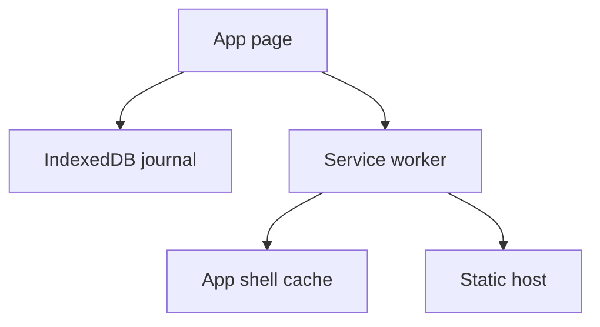
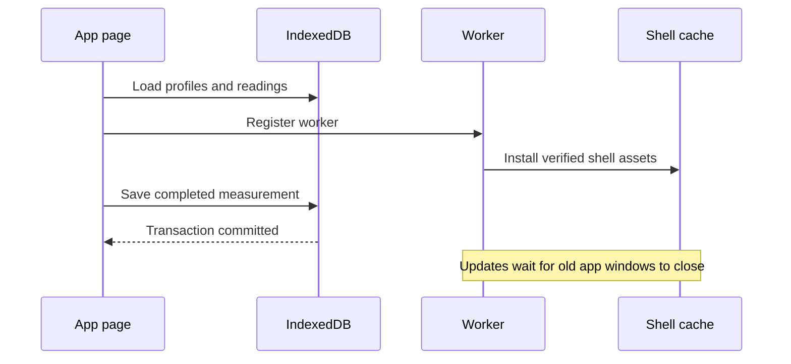

# Pawbreath home-screen app

**Status** Blocked — implementation complete, browser verification and publication pending
**Component** Pawbreath
**Assignee** Codex
**Priority** Normal
**Branch** main (working files only)
**Date** 2026-11-12
**Objective** Provide a usable offline dog breathing journal on a phone.

## Context
The user chose a home-screen web app after discussing replacing Cardalis. Tinkerbox stores standalone web utilities under www. README.md describes this layout. www/queuing_system uses plain HTML/JS/CSS and dependency-free Node assertions. There is no shared frontend framework or root package manifest.

## Requirements
- Original responsive interface, working name Pawbreath.
- Dog profiles with optional photo and owner-entered threshold, initially blank.
- Explicit Start button for 30/60-second measurement, one tap per breath, undo, cancel, completion review, notes, and explicit Save. Zero breaths cannot be saved. Interrupted or backgrounded sessions are cancelled to avoid incomplete counts.
- Timestamp, raw count, elapsed seconds, derived rate and dog ID retained for each reading.
- IndexedDB transactional storage. Report save failures without clearing the result. Multiple tabs must not overwrite a whole stale snapshot.
- History, week/month/all filters, readable chart and exact readings. Confirm deletion.
- Versioned JSON backup and additive transactional restore with validation and idempotent IDs. Existing records win on duplicate IDs. CSV export with formula-safe user text.
- Offline app shell after initial online load, manifest and PNG icons. Changes activate only on a later launch, avoiding reload during measurement.
- Data is device/browser local, with clear backup guidance. Export/import supports moving devices. No cloud sync in this version.

## Implementation Checklist
### Phase 1 — Core experience
- Build static HTML, CSS, app controller and small data module.
- Implement counter, dog editing, history, notes, threshold and exports.
### Phase 2 — Home-screen support
- Add scoped service worker, manifest, PNG icons and installation instructions.
### Phase 3 — Verification
- Exercise counts, interrupted timers, persistence, import validation/deduplication, export, responsiveness and offline reload.
- Update usage README and record observed verification limits.
- After verification, deploy to the newly created owner-private Site using an isolated publishing copy of this source. Verify installation on a phone separately.

## Technical Specifications
All new files live under www/pawbreath. dist/index.html is the entry, dist/app.css and dist/app.js own the interface. dist/data.mjs owns validation, CSV serialization and IndexedDB transactions. dist/sw.js caches only the enumerated local app shell, dist/manifest.webmanifest and icons enable installation. tests/data.test.mjs checks validation and serialization using node:test. README.md documents operation and storage. The ignored local .openai/hosting.json holds the registered Site identity and static directory dist. No build or third-party runtime dependencies.

IndexedDB database pawbreath, version 1, has dogs and readings stores keyed by ID. Each write uses a narrow transaction. Backups contain format pawbreath, version 1, dogs and readings. Validate length limits, finite positive numeric fields, dates, ID uniqueness, references and photo format before any write. Import is atomic and additive. Photo uploads are resized before storage. All user strings render through textContent or escaped markup.

### Integration Seams
App calls the data module for reads/writes and registers the service worker on the same origin. Service worker performs no data writes. Sites hosts static files and supplies owner-only access. Deployment success proves hosting, while iPhone installation and private-gateway offline behavior require real-device verification.

## Testing Notes
Use node --test tests/data.test.mjs and browser tools against local HTTP. Verify both empty and populated states at mobile and desktop widths. Use a controlled clock for timers where supported. Inspect successful service worker install and offline reload. Keep test records confined to local preview.

The browser harness tests failed commits, mid-import rollback, concurrent database connections, hostile markup as text, and deadline taps. Node tests cover malicious CSV values, malformed backups and worker fetch/cache behavior. A live served browser still needs a two-version worker update during a measurement and an offline reload.

## Architecture & Call Flow
The page reads and writes IndexedDB. A separate service worker caches the app shell after initial network access. It never writes journal records. Newly installed workers wait for all existing windows to close before activating, and activation cleans only obsolete Pawbreath shell caches.

| Step | Trigger | Enters context | Cleared/persisted | Turn boundary |
| --- | --- | --- | --- | --- |
| Startup | Open app | Profiles and readings | Database retained | Page lifecycle |
| Measurement | Start and tap | Count and deadline | Unsaved result in memory | Timer callbacks |
| Save | Save reading | Validated record | Transaction commit | Database callback |
| Shell install | Register worker | Enumerated asset responses | Cache retained | Worker lifecycle |
| Update | All old clients close | New shell version | Old app caches removed | Worker activation |

## Review Focus
Timer boundaries, interrupted counting, truthful persistence feedback, atomic restore, duplicate imports, offline shell updates, output escaping and data portability.

## Acceptance Criteria
- A user can add a dog, record a timed reading, save it and recover it after reload.
- History renders actual records with date filtering and notes.
- Backup restores to an empty store and repeated imports create no duplicates.
- Invalid backups leave existing data untouched.
- Shell loads offline after caching, with no externally hosted runtime assets.
- Phone layout fits 375px width with accessible controls.
- Private hosted URL is returned if publication succeeds, and remaining device verification is disclosed.

<!-- review pending -->

## Progress
- Site registered and manifest persisted.
- Implemented app UI, dog profiles and photos, counter, history chart, threshold, notes, JSON restore and CSV export.
- Added scoped offline worker, home-screen manifest and raster icons.
- All 11 Node tests pass. App, data module, worker, and generated browser harness pass syntax checks.
- Created a reproducible browser harness with isolated test databases. Browser execution remains blocked.

## Findings
Five review findings recorded. Added lifecycle diagrams and moved publication after verification. Added failure-injection, concurrent-write, hostile-text, and timer checks to the browser harness. Added CSV injection tests. Real worker-update testing remains pending because browser/server access is blocked.

## Issues & Solutions
- Local HTTP listener was denied with EPERM by the execution sandbox.
- Hosting source Git endpoint could not resolve. Site creation succeeded but no source version was published.
- Browser tool stalled and was later removed. Computer-use browser rejected file navigation under its URL policy. No browser verification result is claimed.
- Review metadata was moved to scratch after integrating findings to keep the repository change focused on the app.

## Final Results
Working source is in www/pawbreath/dist with no runtime dependencies. Default name is Pawbreath. Storage is device-local. Remaining acceptance checks are real browser interaction, mobile layout, offline updates, phone installation, and deployment once network access is available.

## 2026-11-12 repository move
The app moved from `tinkerbox/www/pawbreath` into the standalone repository <https://github.com/vr000m/pawbreath>. Paths above describe the original implementation location; current paths are relative to this repository root, with the app in `dist/`. Initial import uses `feature/initial-import`. The root `.gitignore` excludes local hosting configuration, credentials, editor state and verification output while retaining app source. Hosting identity is preserved locally in the ignored `.openai/hosting.json` file. Browser, device and deployment verification remain pending.

## 2026-11-12 backup round-trip correction
Review found that additive restores can exceed the backup validator's aggregate record limits, and exports can exceed the file reader's 20 MB limit. These limits invalidate the data-portability requirement above: every valid stored journal must remain exportable and readable by restore, within browser memory and storage capacity.

Remove aggregate count and file-size limits while retaining format, per-record, uniqueness and reference validation. Route file parsing through a shared validated reader in `dist/data.mjs`, used by the restore handler in `dist/app.js`. Cover journals above 100 dogs and 50,000 readings, additive backup combinations, files above 20 MB and invalid file contents in Node regressions. Increment the service-worker cache version for changed shell assets and document the browser resource boundary in README.md. This corrects backup handling only; the outstanding browser/device/deployment checks remain pending.

Implemented and verified: all 14 Node tests pass, including the new aggregate and file-size regressions; the 11-check browser harness also passes in Chromium. Export, file reading and transactional restore all use `validateBackup`. The service-worker shell cache is now v2. Real-device installation and a two-version worker update remain unverified.

## 2026-11-12 Cloudflare deployment tooling
Cloudflare Workers Static Assets at `pawbreath.com` supersedes the original Sites publication target. Use an assets-only Worker with `dist/` as the complete public directory and the apex as its custom domain. No server-side journal, database binding or runtime secret is needed. The existing local Sites identity is retained but is not used by this workflow.

Add a pinned Wrangler development dependency and lockfile, `wrangler.jsonc`, a root `justfile`, and `scripts/cloudflare.sh` for external credential loading and an authentication check before deployment. Recipes cover installation, local preview, the full Node suite, account verification, a credential-free dry run and an explicit production deployment. Keep external secrets and generated Wrangler state out of Git. Update README with these commands and deployment prerequisites. Verify recipes, tests, a dry run, local HTTP serving and read-only account/domain access before committing; do not publish as part of tooling setup.

Implementation branch: `feature/cloudflare-deploy`. The required credential names exist in `~/.secrets/cf.env`; read-only checks confirm the token is active, Wrangler authenticates, and `pawbreath.com` is active in the configured account with no existing Worker domain association. Permission metadata is not readable with this token, so deployment write permissions remain unverified.

Validation: clean `just install`, all 20 Node tests and syntax checks, and `just deploy-check` pass. The local Workers runtime serves the root and the other six shell assets with HTTP 200; credential and repository configuration paths return 404. `/index.html` returns a 307 redirect to `/` (default `auto-trailing-slash` HTML handling), which the service worker's install rejects as a redirected response, so `dist/sw.js` no longer precaches `./index.html` (the scope root is the shell document) and a regression test covers it. Tests cover credential precedence (exported token versus default and explicit files), missing files and authentication failure before deployment. Deployment and `just cf-whoami` use `whoami --json` because Wrangler's human-readable mode can exit successfully while unauthenticated. No production deployment or DNS mutation was performed.
